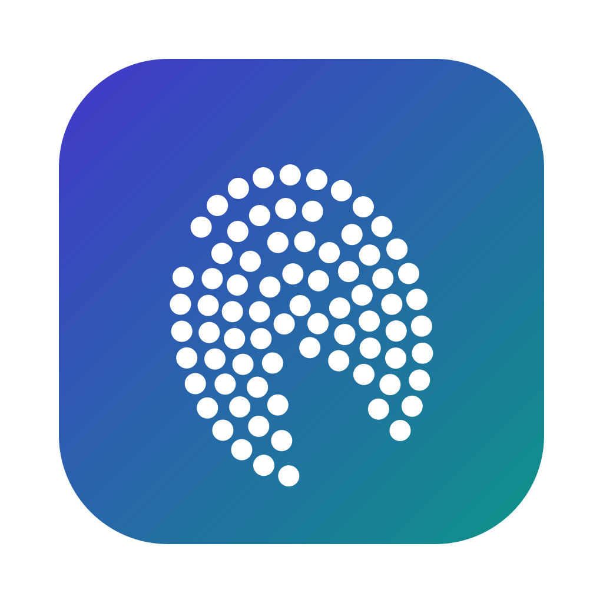

<p align="center"></p>

# PeerSig

PeerSig tells which applications send which TLS fingerprints. Volunteers run
a small app that watches the start of every encrypted connection their
computer or phone makes (the TLS or QUIC ClientHello), computes its
[JA4](https://github.com/FoxIO-LLC/ja4/blob/main/technical_details/JA4.md)
fingerprint, and finds the application behind it: name, version, browser
engine, TLS library. Once a week, the app contributes these
*(fingerprint, application)* pairs to a study, as anonymous ballots.

The result is a ground-truth table for traffic classification: a JA4 seen on
a network can be labelled "Microsoft Teams 26289 (Chromium 156)" or "macOS
softwareupdated" because volunteers' machines said so.

The name stands for *peered JA4 signatures*. The logo is a fingerprint made
of dots: each dot is one participant's anonymous ballot.

## Privacy

What leaves a participant's computer, and only after they could review it:

- per week, each *(application name and version, kind, engine, system and
  its major version, transport, JA4)* seen;
- if they opt in, the server names (SNI) that **non-browser** applications
  connected to, each with the JA4 of that connection (Teams sending
  `t13d1516h2_…` to `teams.microsoft.com`). Browsers' names are never
  collected: no browsing history.

Never: IP addresses, times, how often, file paths, command lines, user or
host names. On top of that, the system has several layers of protection:

| Layer | What it does |
| --- | --- |
| Review | Each week's list waits 24 h in the app; the participant can untick anything. Items that may say something about them (a sensitive word, their name, or what Apple's on-device model points out on a Mac) come first; this stays on the device. Nothing is sent while the app is not running. |
| Anonymous ballots | Every item is a separate ballot with a blind-signed token ([RFC 9474](https://www.rfc-editor.org/rfc/rfc9474)), as in anonymous e-voting: the server knows a ballot comes from an enrolled participant, not which one, nor which ballots come from the same person. |
| Oblivious HTTP | Ballots go through a relay ([RFC 9458](https://www.rfc-editor.org/rfc/rfc9458)): the relay sees addresses, not content; the server sees content, not addresses. Run by another party, neither can tell who sent what. |
| Counts only | The server stores one counter per item and week. No ballots, no arrival times. |
| Thresholds | An item is published only once *k* participants reported it in the same week (3, or 5 for domains). |

Differential privacy (noise on what is sent or published) is a future
plan: see [docs/privacy.md](docs/privacy.md#future-plans) for why the first
design was removed.

[docs/privacy.md](docs/privacy.md) explains what each party learns and the
limits. [docs/protocol.md](docs/protocol.md) is the wire protocol.

## For participants

Get an enrollment code on the study's page,
[peersig.org](https://peersig.org): in one click from
the UCLouvain network (or its VPN), or by e-mail, or with a GitHub account. The code only keeps the collection closed to people who
are not taking part; it does not identify your ballots. Then download the
app from the [releases](https://github.com/UCLouvain-ENSG/peersig/releases)
page (macOS `.dmg`, Linux `.deb` or `.rpm`, Windows `.msi`, Android `.apk`), open it and enter the
code: the server and relay addresses are filled in. On macOS and Windows,
the app installs its capture service once; the system asks for an
administrator's password or consent. Installing a newer PeerSig does not
update that service: the app then offers to, and asks again. Nothing else
needs installing: on
Windows, PeerSig uses the packet capture built into the system.

The PeerSig icon in the menu bar shows what is happening: a fingerprint while
it captures, a faded one when paused or not running, an arrow while a report
is being sent. The window shows what was seen this week, what will be sent,
and what was sent before. When a new version of PeerSig is published, the
window and the menu offer to install it; nothing installs until you click.

The release builds are not signed by Apple yet: the first time, macOS refuses
to open the app. Open *System Settings → Privacy & Security* and choose
*Open Anyway*.

On Android, PeerSig captures through a VPN of its own, which stays on the
phone and forwards every connection unchanged: Android asks once whether
to allow it, and a notification stands for the tray icon. See
[docs/android.md](docs/android.md).

## For researchers: running a collection

```sh
cargo build --release -p peersig-server -p peersig-relay

# Collection server (behind TLS, with access logs off):
peersig-server --db peersig.db serve --listen 127.0.0.1:8080 \
    --public-url https://peersig.example.org \
    --smtp-url smtp://127.0.0.1:25 --mail-from 'PeerSig <peersig@example.org>'  # codes by e-mail
peersig-server --db peersig.db codes add --count 20      # or hand out codes yourself
peersig-server --db peersig.db stats
peersig-server --db peersig.db export --format classifier > ja4_peersig.json

# Relay, on a machine you do not control (another lab, the DPO's office):
peersig-relay --listen 127.0.0.1:8081 --gateway https://peersig.example.org
```

The `classifier` export is a list of `{ja4_hash, desc, source, fetched}`
records, one per JA4. [docs/deploy.md](docs/deploy.md) covers TLS, Docker,
enrollment (by hand, e-mail or GitHub), parameters and releases.

**Dedicated observers** are machines the study runs (lab servers, test
laptops) whose traffic may be published. With a code from `codes add
--observer`, they report every day, and each day's items are published at
`/v1/released/observers` without threshold (the site's `/data` page shows
both tables). The code alone makes a machine an observer, whatever runs
PeerSig on it: [docs/observers.md](docs/observers.md).

**On a server** without a desktop, participants and observers alike install
the `peersig-headless` package and run `sudo peersig configure`:
[docs/headless.md](docs/headless.md).

## Building from source

Rust (stable), and libpcap (`libpcap-dev` on Debian/Ubuntu; Windows needs
none). The app also needs
[Tauri's prerequisites](https://v2.tauri.app/start/prerequisites/).

```sh
cargo test                       # probe, protocol, server, relay, observer
cargo build --release -p peersig-probe
cp target/release/peersig-probe crates/app/binaries/peersig-probe-$(rustc -vV | sed -n 's/host: //p')
cargo test -p peersig-app
(cd crates/app && npx @tauri-apps/cli@2 build)                    # .app/.dmg, .deb/.rpm/.AppImage or .msi
```

Use `--locked`: `Cargo.lock` pins `derive_more` to 2.0.1, the last release
`blind-rsa-signatures` 0.15 builds with.

On Windows (MSVC toolchain) the probe has no capture library to link: it
uses the system's packet capture (NDIS, through ETW). A live capture needs
an administrator terminal. The sidecar is
`peersig-probe-x86_64-pc-windows-msvc.exe`.

```powershell
cargo build --locked --release -p peersig-probe
copy target\release\peersig-probe.exe crates\app\binaries\peersig-probe-x86_64-pc-windows-msvc.exe
```

The Android app needs the Android SDK and NDK, JDK 17 and
[cargo-ndk](https://github.com/bbqsrc/cargo-ndk); Gradle builds the native
library with it ([docs/android.md](docs/android.md#building)):

```sh
cargo test -p peersig-android                  # the native side, on the computer
(cd android && ./gradlew assembleDebug)       # app/build/outputs/apk/debug/app-debug.apk
```

| Crate | What |
| --- | --- |
| [`crates/probe`](crates/probe) | Capture daemon: JA4 of every ClientHello (TCP, QUIC, DTLS), and the process and application behind it. Writes local logs; never uses the network. A library too, for the Android app. See its [README](crates/probe/README.md). |
| [`crates/app`](crates/app) | Tray app (Tauri): shows the logs, lets the participant remove items, sends the weekly ballots. Its window (`crates/app/ui`) is the Android app's too. |
| [`crates/client`](crates/client) | The participant's side, shared by the desktop and Android apps: settings, the report cycle, the window's commands. |
| [`crates/android`](crates/android), [`android`](android) | The Android app: the capture behind its own VPN (the probe's pipeline, apps named by uid), and the Gradle project ([docs/android.md](docs/android.md)). |
| [`crates/proto`](crates/proto) | What a ballot may contain, tokens, OHTTP, wire format, client. |
| [`crates/server`](crates/server) | Collection server: token issuance, OHTTP gateway, counters, release. |
| [`crates/relay`](crates/relay) | OHTTP relay. |
| [`crates/headless`](crates/headless) | `peersig`: PeerSig without a desktop (weekly ballots, or an observer's daily report), and the `peersig-headless` package. |
| [`assets/logo`](assets/logo) | The logo, generated by `make_logo.py`; `render.sh` makes the app icons. |
| [`scripts`](scripts) | `mirror_release.py` copies a GitHub release to the site's download directory. |

## Status

macOS is supported: per-packet process attribution (PKTAP), bundle versions,
Chromium, Electron, Gecko and WebKit engines, XPC services credited to their
app, background downloads credited to the app they work for. Linux captures
and finds processes through procfs, but has not been tested in the field.
Windows captures with the packet capture built into the system (NDIS, read
through ETW: nothing to install) and finds the process of each ClientHello
in the TCP and UDP tables; applications are named by their version
resources and MSIX packages, svchost processes by the service they run
(`wuauserv`, `BITS`, `DoSvc`), WebView2 and Electron helpers are credited to
their app. A first live capture on Windows 11 attributed 17 of 20
ClientHellos; it has not been tested in the field. Android (10 and later)
captures through the app's own VPN and credits each ClientHello to the app
the system names by uid; it has run on an emulator, not in the field yet.

## License

Apache-2.0: see [LICENSE](LICENSE).
